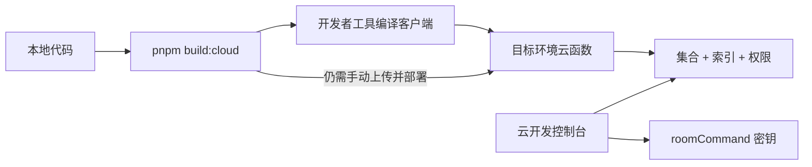
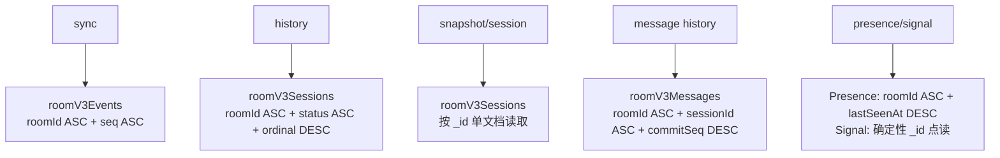
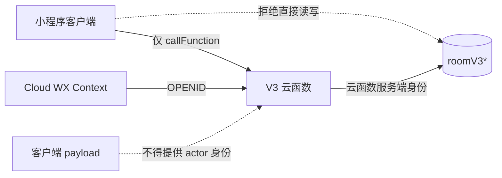
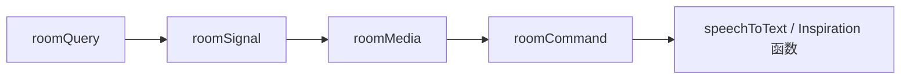
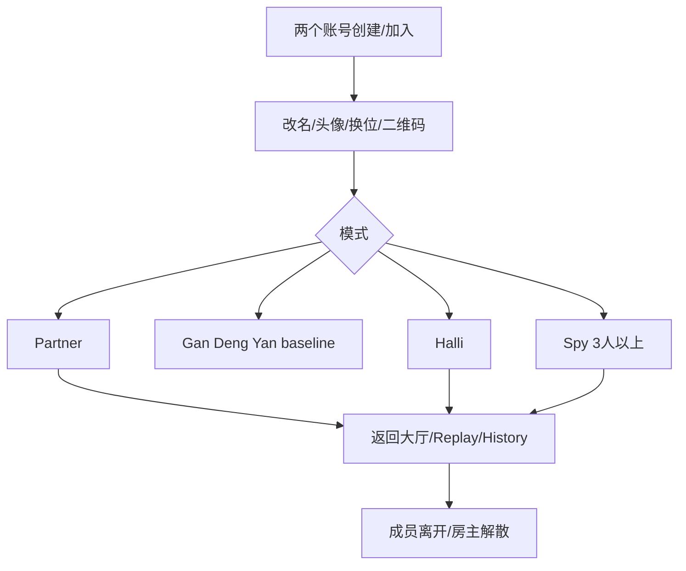
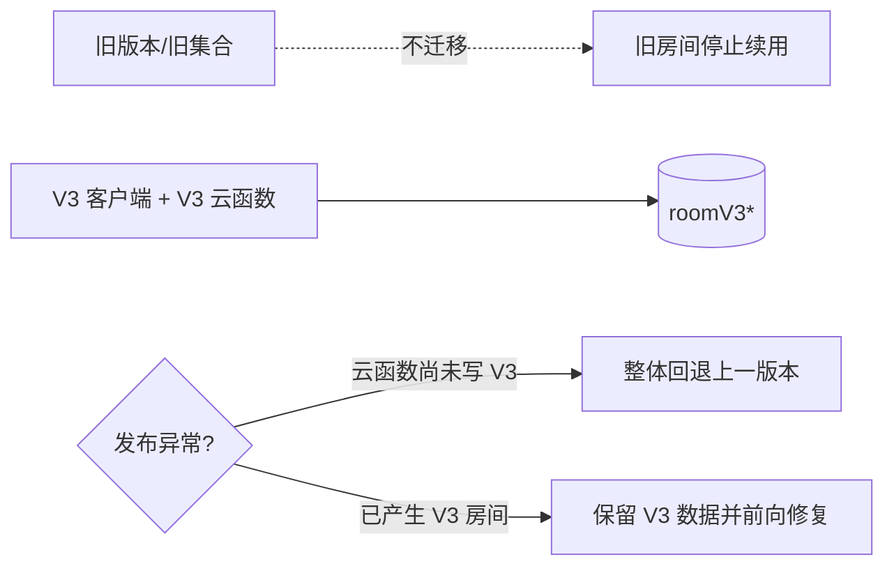

# 房间协议 V3 部署与验收清单

> 状态：仓库已实现；以下 CloudBase 资源创建、权限配置、云函数发布和真机验证需要在目标环境执行。
>
> 不迁移旧数据。V3 客户端只连接 `roomV3*` 集合；切换后创建新房间验证。

## 0. 开发者工具直接运行是否足够

**不够。** 微信开发者工具的“编译/预览”只更新小程序客户端，不会自动执行以下操作：

- 创建 `roomV3*` 云数据库集合；
- 创建组合索引或修改集合权限；
- 将本地 `cloudfunctions/*` 上传并部署到云端；
- 为 `roomCommand` 配置 `ROOM_PROTOCOL_SERVER_SECRET`。



首次运行或切换环境时，必须先确认开发者工具选择的云环境与 `app.js` 中的
`CLOUD_ENV_ID` 一致，然后完成第 2～5 节。以后修改
`packages/room-*` 或任一 `cloudfunctions/*/src` 后，也要重新构建并部署相关云函数。
客户端与云函数版本不一致时，不属于受支持的运行方式。

当前 Event Schema 版本以 `packages/room-contracts/index.js` 为准；Patch 包含 `set/remove/splice`，每个 Event Group 还
记录生成补丁时的 `viewSchemaVersion`。本次不迁移旧数据，必须在空的 V3 集合上将客户端与
全部 V3 云函数作为同一发布单元部署，不能混用不同 View/持久化 Schema 的云函数。

产品上线前若修改了 `SCHEMA_VERSION`，请直接清空所有 `roomV3*` 测试集合后重新建房。服务端会
把版本不匹配的 Room 当作不存在，并将对应 `roomV3ActiveByUser` 视为悬挂索引；账号下一次创建
房间时会在事务内修复该索引，不需要数据迁移或客户端兼容分支。

## 1. 发布依赖图


## 2. 新集合

| 集合 | 主键/用途 | 生命周期 |
|---|---|---|
| `roomV3Rooms` | `_id=roomId`；Room 控制文档 | 保留 |
| `roomV3Sessions` | `_id=sessionId`；一个文档保存 Session + 该场次全部 Facts | 保留 |
| `roomV3ActiveByUser` | `_id=hash(userId)`；当前房间唯一索引 | 离开/解散删除 |
| `roomV3Actions` | `_id=hash(scopeKey:commandId)`；Receipt | 建议 30 天归档/清理 |
| `roomV3Events` | `_id=roomId_seq`；每个 Command 一个事件组，含 raw/public/Actor 扇出投影 | 建议保留 7 天 |
| `roomV3Messages` | Partner 匿名表达 | 按产品周期清理 |
| `roomV3Presence` | 任意房间协议顺带续租的设备在线租约 | 按 `lastSeenAt` 清理；查询已在索引层排除过期租约 |
| `roomV3Signals` | 房间级公开信号聚合文档与成员级冷却凭证 | 按顶层 `expiresAt` 清理 |
| `roomV3Media` | 房间二维码等可再生引用 | 可再生 |

`inspirations` 继续独立存在，不属于房间协议集合。

## 3. 必需索引



| 集合 | 索引字段 | 必需 |
|---|---|:---:|
| `roomV3Events` | `roomId ASC, seq ASC` | 是 |
| `roomV3Sessions` | `roomId ASC, status ASC, ordinal DESC` | 是 |
| `roomV3Messages` | `roomId ASC, sessionId ASC, commitSeq DESC` | 是 |
| `roomV3Presence` | `roomId ASC, lastSeenAt DESC` | 是 |

`roomV3Signals` 当前按 `_id=hash(roomId:PUBLIC_SIGNALS)` 一次点读房间公开信号聚合文档；
设计问题催促另按
`hash(roomId:sessionId:DESIGN_PROBLEM_NUDGE:cooldown:memberId)` 点写成员冷却凭证，
该凭证不投影给客户端。两类文档都不需要组合索引。其余读取
使用确定性 `_id`，不需要额外业务索引。

独立的 `inspirations` 列表已把用户、房间、场次过滤和更新时间排序全部下推到数据库，需创建：

| 查询范围 | `inspirations` 索引字段 |
|---|---|
| 当前用户全部 | `userId ASC, updateTime DESC` |
| 当前工作坊全部场次 | `userId ASC, roomId ASC, updateTime DESC` |
| 当前场次 | `userId ASC, roomId ASC, sessionId ASC, updateTime DESC` |

删除旧的 `createTime` 唯一索引：时间戳不是业务唯一键，同一毫秒保存两条灵感不应冲突。以上索引应在
部署新版 `listInspirations` 前创建完成；该云函数不再进行 `_openid` OR 查询或拉取 100 条后内存过滤。

## 4. 权限边界



部署门禁：

- 所有 `roomV3*` 集合关闭客户端直接读写。
- 仅云函数运行身份可访问集合。
- `roomV3Sessions`、`roomV3Events`、`roomV3Actions` 均不开放客户端读权限；其中包含私密事实或成员投影。
- 日志不得输出 openid、Spy 词语/身份、投票明细、消息或素材正文。
- `roomMedia` 二维码通过 Room 单文档校验开放状态和成员身份，首次生成/强制刷新仅 Host；普通成员可读缓存。私有素材 `tempUrls` 仍按当前/历史 Member Snapshot 可见文件白名单鉴权，不可降级为仅成员校验。
- `roomSignal` 只接受已登记类型：静默声贝须绑定当前 session/turn 且 Silent 未过期，仅当前静默行动者可写，其他玩家消费同一信号展示一致的声浪边框和声音过大提示；设计问题催促须在 `COLLECT_DESIGN_PROBLEMS` 且调用者已提交；设计问题编辑态须在 `SELECT_DESIGN_PROBLEM` 且仅房主可写。

## 5. 构建与部署顺序

```bash
pnpm install
pnpm test
pnpm build:cloud
```

云函数发布顺序：



应发布：

```text
roomQuery
roomSignal
roomMedia
roomCommand
speechToText
saveInspiration
getInspiration
listInspirations
```

不要重新部署已删除的 legacy 房间云函数。`roomCommand/roomQuery/.../index.js` 是构建产物，修改 `packages/*` 或 `src/entry.js` 后必须重新执行 `pnpm build:cloud`。

上传所有 V3 云函数时必须选择「上传并部署：云端安装依赖」，不能只上传代码。构建脚本会把
`wx-server-sdk`（以及语音函数的腾讯云 SDK）保留为云端依赖；漏装依赖会同时导致 Command、Query、
Signal 和 Media 不可用，典型表现是创建/离开长时间无响应且二维码一直生成。新版入口会尽量返回
`MODULE_NOT_FOUND`；若仍看到客户端 `errCode: -504002`，说明函数在进入 `main` 前就失败了，需要重新
安装依赖。在云函数控制台核实 `roomCommand`、`roomMedia` 运行超时均为 **10 秒**；本地构建或上传
不等于运行配置已经生效。客户端请求预算为 12 秒（以代码常量为准），网络耗时还包含平台调度、
冷启动和响应传输，因此“3 秒执行超时”的失败在客户端可能到 4～5 秒才收到。
提高运行上限只消除过早中断，不等于提速。`roomCommand:perf` 分解事务/Presence/同步耗时，
`roomMedia:perf` 分解授权、缓存读、生成码、上传、缓存写、临时 URL；均不记录用户私密内容。
基准应分别记录首次生成与缓存命中、冷/热调用，并把客户端总耗时与云端处理耗时分开比较。
请求内的 Presence/同步、二维码授权/缓存预读、缓存写入/临时 URL 阶段可重叠，阶段耗时之和
可能大于总耗时，不能以阶段相加作为提速依据。发布后比较相同人数、相同数据规模的 P50/P95；
本地延迟测试只能证明依赖顺序和收口正确，不能代替云端性能测量。

房间二维码固定使用 `env_version=trial`，不再读取 `QR_ENV_VERSION`。即使云端仍残留旧的
`QR_ENV_VERSION=develop` 配置，也不会生成开发版码；可以在方便时删除该遗留变量。体验版二维码
由微信校验体验成员权限，没有权限的账号应被限制进入，云函数不得自动回退到开发版或正式版。
部署新版 `roomMedia` 后，旧 `roomV3Media` 记录因为没有 `envVersion=trial` 标记，会在 Host 下次
进入大厅或刷新二维码时自动重建。

协议安全环境变量（仅 `roomCommand`）：

| 变量 | 要求 |
|---|---|
| `ROOM_PROTOCOL_SERVER_SECRET` | 必填；至少 32 字节的随机密钥；各环境独立；发布新版本时保持稳定，不得暴露到小程序端 |

该密钥用于以 HMAC 派生可重试但不可由客户端预测的领域随机种子。未配置时，`roomCommand` 会明确返回 `INTERNAL_ERROR`，不会退回公开常量。

## 6. 冒烟验收



| 编号 | 场景 | 通过条件 |
|---|---|---|
| R1 | 创建、微信原生“扫一扫”加入、重复点击/弱网重试 | 体验成员进入体验版且只有一个房间、一个成员、连续 Event、同 Receipt；非体验成员被微信限制，不能落入开发版 |
| R2 | 6 人并发加入 | 席位 1～6 唯一；第 7 人 `ROOM_FULL` |
| R3 | 中途加入 | 成为 Member，但不是当前 Session Participant，停留大厅观察 |
| R4 | Partner 评分并发 | 不漏分、不重复计数；最后一分后可进入 Statement |
| R5 | Partner 四种特殊行动与收尾两种票型 | 路由、Turn 归档、Rune/Review/Question 分支正确 |
| R6 | Halli 全员创意与投稿者离开 | required 集合同步缩减；可进入汇总并完成 |
| R6a | Gan Deng Yan baseline 完整流程 | 独立模式值，跳过情境并按 Halli baseline 完成首位、活动、创意、汇总与重玩 |
| R7 | Spy 分牌、发言、弃票、平票、淘汰、两侧胜负 | 结算前其他成员和公共事件无秘密 |
| R8 | 行动者/投票者中途离开 | 同一提交内缩减 required/submitted；旧票不参与当前裁决；推进或结算正确 |
| R9 | 前后台切换、Event 人为过期/缺口、积压超过 25 条 | 恢复时直接 Snapshot；Sync 在同一响应内交付 Snapshot；页面状态可完整还原 |
| R10 | 离开/踢出/解散后旧 Presence/Signal | Snapshot 不再展示旧成员或旧 Turn 信号 |
| R11 | History / Session / Leaderboard | ordinal 分页无重复；精确 sessionId 回看；离房/被踢/解散后的原参与者仍可还原自己的归档 View |
| R12 | 关闭旧集合客户端权限 | V3 功能不受影响，客户端无法直读写房间数据 |
| R13 | 语音上传期间切换 Turn/Statement | 旧 session/turn/workflowStep 被拒绝，音频不会写入新阶段 |

### 6.1 关键变更的多账号手动回归

使用 A 房主、B 行动者、C 普通成员，新建专用测试房间。Snapshot 与 Event 路径分别以
后台恢复/重新编译和在线操作验证；只在这个测试房间模拟延迟指令，不操作其他用户的房间。

| 编号 | 操作 | 验收结果 |
|---|---|---|
| M1 | A 创建房间，B/C 输入房号加入；首次打开二维码，再关闭重开 | 创建/加入后直接进入大厅；席位无重复；二维码首次生成与缓存命中都成功，分别记录耗时 |
| M2 | A 进入模式选择→后退→再次进入；B/C 同时观察；选择期间重新编译，从首页「查看房间」再点「选择模式」 | 全员按权威 View 在大厅和等待页间切换；没有遗留等待叠层；重新打开恢复现有选择，不重复 BEGIN，不出现错误提示 |
| M3 | 在测试控制台保存第一次选择的 `navigation.back.context`，取消并重开后用新 `commandId` 发送旧 CANCEL/START | 返回 `STALE_CONTEXT`，当前选择页不关闭、不创建场次；用原已成功 `commandId` 重试只重放 Receipt，不再次取消 |
| M4 | B 通过缺省或错误 `isHost` 的 `brainstormMode` URL 进入；A 通过缺省角色 URL 进入 | 不出现 `goRoomPage is not a function`；两者均恢复各自权威路由，房主仍可选择模式 |
| M5 | Partner 选情境、提交/选择问题、确认首位；B/C 每个等待环节切后台再回来 | 选择情境、确认首位的等待屏幕及时关闭；SetupShell 恢复当前屏幕，不依赖临时 redirect 完成推进 |
| M6 | B 成为 Partner 行动者，打开反面随机拼预览；关闭/重建叠层后重新打开，再按页面后退 | 在线成员徽标与预览一致；重建后仍显示预览；首次后退清除预览回转盘，不消耗行动，不直接退出游戏；第二次返回游戏 |
| M7 | B 开启静默，A/C 观察；B 切后台/回来、拒绝授权、结束静默；MP3/PCM 双向切换、页面销毁/重建、换 Turn 时延迟原生 onStop 超过两秒；不再发送新 View，仅交付迟到停止确认；等待期间再离页或换一次意图；可控设备 Adapter 注入启动中 stop 失败、迟到/重复 onStart，以及错误 hook 同步离页并确认停止 | 仅当前行动者发送声级，非行动房主不采 PCM；onStart 才确认录音；已取消 run 首次迟到开始只补一次停止，不循环重试，仍只在 onStop 后交接；停止超时不抢占，迟到确认自动启动最新可见意图，旧页清理/错误 hook 重入不干扰新页；旧部分音频丢弃，自然分段绑定旧上下文；授权拒绝/设备失败不逐次重试，已离页回调不启动设备或刷新 UI |
| M8 | Master 开启/结束，轮次评分、表态后切卡并恢复页面 | 所有人效果一致；非行动者可进入评分；卡片评分/表态保留，Master 专属边框、牌型与卡牌数量正确 |
| M9 | Gan Deng Yan 选首位→规则→创意→汇总→编辑→完成→重玩；Halli 选情境后走同样后半流程 | 前者跳过情境且展示自己的规则，后者保留情境；全员路线和后退边界正确，汇总完整、重玩不混入旧场次 |
| M10 | Partner 结束投票的继续/收尾两条分支；收尾 Rune→Review→Question→榜单 | 继续分支回游戏；收尾卡唯一且内容/图片完整；渐进公开和评分人数正确；不可逆运行态没有伪业务后退 |
| M11 | 问题输入粘贴超过 50 字，催促；灵感输入、头像双击；输入时发生无关房间刷新 | 立即截断 50 字；催促有冷却并反馈到未提交者；草稿/焦点不丢失；头像手势不聚焦；原生输入在键盘上方，关闭后高度清零 |
| M12 | Command 未返回时观察 Query，结束后连续操作，再静置；前后台切换/关闭时保留在途 current、Snapshot 或 Sync，延迟旧成功/失败响应；创建提交后再切后台 | 请求串行且从上一请求结束静默 2 秒后自动 Sync；旧响应不安装 View、不发布错误、不继续旧握手；已提交 Command 仍返回原回执，恢复按已确认房间读取当前 Snapshot，无旧路由或无效快照错误 |
| M13 | B/C 离开、A 解散，全员再创建/加入；重复/失败请求重试 | 全员退出旧房间；旧 Presence/Signal 不残留；无幽灵成员或错误 `ALREADY_IN_ROOM`；记录冷/热调用耗时，不以超时上限当作性能结论 |

麦克风真实采样、iOS/Android 键盘高度、安全区与系统侧滑必须在真机复测；开发者工具的模拟
事件和虚拟账号只能验证协议、页面状态、生命周期和输入接线，不能替代这些原生行为验收。

### 6.2 手动验收的界面入口

先在首页由 A「创建房间」，B/C「加入房间」（开发工具可输入大厅展示的 8 位房号，真机扫码）。
以下各条使用同一组成员；特殊行动每 Turn 只能采用一次，测试不同特殊行动需要推进到新的 Turn。

| 对应回归 | 如何进入 | 重点观察 |
|---|---|---|
| M1、M13 | 首页→创建/加入→大厅；大厅底部「退出房间/解散房间」 | 二维码首次/再次加载；离开后首页不再显示旧房间，再创建/加入无错误 |
| M2、M4 | A 大厅→「选择模式」→「上一页」→再选；选择中重新编译→首页「查看房间」→「选择模式」 | B/C 等待页与大厅同步切换；恢复的是已有选择；缺省/错误角色 URL 由维护者在工具中单独验证 |
| M5、M11 | A 选择「创意合伙人」→「确认模式」→选择情境；全员提交设计问题→A 选择问题→选择首位→确认 | 在等待情境/首位确认时将 B/C 切后台再回来；提交输入、催促、房主编辑提示正常；长文本立即限制 50 字 |
| M6 | 选择 B 为首位→确认进入游戏→B 底部「特殊行动」→「求助运气」→反面随机拼预览 | A/C 同步显示预览标签；B 重开叠层可恢复预览；首次返回回转盘并清除标签，第二次返回游戏 |
| M7 | Partner 新 Turn 的当前行动者→「特殊行动」→「全场静默」 | 非行动房主不能结束静默；其余成员仍可打分/匿名表达；行动者后台释放采样，拒绝授权不重复提示 |
| M8 | Partner 新 Turn→当前行动者「特殊行动」→Master；全员评分→A「开始表态」→讨论/下一 Turn | 其他成员进入评分；边框/牌型同步；切换历史卡并重新进入，表态与评分记录不丢失 |
| M9 | 大厅→「选择模式」→「干瞪眼模式」或「德国心脏病模式」→「确认模式」 | 干瞪眼直接选首位、四步规则；德国心脏病先选情境、六步规则。A「结束游戏」→全员提交创意→修改/保存→完成→重玩 |
| M10 | Partner 当前行动者→「特殊行动」→「收尾阶段」；其他成员选择「通过/存在疑问」 | 存在疑问回游戏；全员通过进入 Rune→A「下一步」→Review→A「结束脑暴」→榜单；重建后收尾素材完整且不重复 |
| M11 | Partner 游戏页的灵感、匿名表达；收尾 Review 的复盘输入 | 输入时让另一成员评分/发送；草稿与焦点不丢失；双击顶部头像不拉起键盘。真机检查输入位置与安全区 |
| M12 | 任一在线房间页；打开工具 Network 后连续点击真实业务按钮，再停止操作；B/C 切后台/重新编译 | Command/Query 串行，上一请求完成后静默 2 秒；恢复安装当前 Snapshot，无无效快照、旧屏幕或重复等待页 |

M3 是协议维护者的延迟/重放测试，不需要普通体验者手工构造请求；自动测试必须同时覆盖旧选择
Context 被拒绝和同一成功 Command ID 的幂等 Receipt 重放，不能用页面点得快代替。

## 7. 数据正确性抽查

```text
roomV3Rooms.eventSeq == 当前最大 Event.seq
roomV3Rooms.currentSessionId == null 或对应 roomV3Sessions._id
roomV3Sessions.facts 只属于该 Session，当前场次切换时旧文档保持不可变
每个 OPEN Member 恰有一个 roomV3ActiveByUser
每个 accepted Receipt 的 committedThroughSeq 可在 Room/Event 中验证
同一 roomId 下 Event.seq 无重复、无倒序
每个 Event 文档只对应一个 Command；publicPatch + 本人 actorPatch 可从前一 View 还原下一 View
同一 Session 只有冻结 Participants；中途加入者不在其中
Spy SETTLED 前 Public View/Event 不含 role/word/blurb
```

## 8. 观察与告警

| 信号 | 告警建议 |
|---|---|
| `DEPENDENCY_UNAVAILABLE` / `INTERNAL_ERROR` | 连续 5 分钟出现即检查索引、权限和事务限制 |
| `delivery=SNAPSHOT` | 比例突增时检查 Event TTL、缺口、超过 25 条的积压或客户端生命周期 |
| `COMMAND_ID_CONFLICT` | 检查客户端 commandId 生成与复用 |
| 事务冲突/重试 | 按房间与命令类型观察热点 |
| `[roomCommand:perf]` | 按 Command `type` 分别统计 `transactionMs/presenceMs/syncMs/totalMs` 的 P50/P95；`syncSource=QUERY/FAILED` 突增时检查客户端水位与 Event 连续性 |
| `LIMIT_EXCEEDED` / RoomSession 文档大小 | 协议在 6 MiB 安全预算、500 消息、1000 素材、200 常规 Turn 前拒绝增长；引导结束场次，不得放宽到数据库硬上限 |
| Presence stale | 检查云函数延迟和前后台生命周期 |

## 9. 切换与回退



- 客户端与全部 V3 房间云函数作为一个发布单元切换。
- 回退时不要让旧客户端读取 `roomV3*`，也不要让 V3 客户端读取旧集合。
- 已产生 V3 房间后优先前向修复；整体回退只服务旧数据，V3 房间暂时不可继续。
- 不建立 legacy fallback、兼容字段、双写任务或旧数据迁移脚本。

## 10. 静态插图与 CDN

下面的 CDN 插图不进小程序代码包，本地文件仍保留在仓库，由 `packOptions.ignore` 排除。
云存储对象平铺在 `miniprogram-static/` 根下，key 为文件名（不含仓库目录）：

- `packageSpy/assets/interactionCards/webp/*` → `miniprogram-static/开关3x.webp` 等
- `assets/subAwait/wait-hero-5a8ea5.webp` → `miniprogram-static/wait-hero-5a8ea5.webp`
- `assets/home/empty-history-6f27f1.webp`
- `assets/brainstormMode/mode-cover-*.jpg`
- `assets/halliGalli/step-*.webp`

以下 12 张流程说明图使用 `/assets/...` 本地路径并随小程序打包，不依赖 CDN，
不在 `packOptions.ignore` 或静态上传清单中；重新编译客户端即可生效，无需上传云函数或图片：

| 本地资源 | 数量 | 使用位置 |
|---|---|---|
| `assets/ganDengYan/rule-*.jpg` | 4 | 干瞪眼规则页 |
| `assets/partnerMode/actions/action-*.jpg` | 4 | Partner 普通/静默行动卡 |
| `assets/partnerMode/actions/reverse-step-*.jpg` | 4 | 反面随机拼预览 |

发布前使用开发者工具检查实际包体积，并验证上述三个入口的图片加载；不能仅以仓库文件存在作为验收。

Halli 规则页优先加载 CDN WebP；约 250 KiB 的同源 `step-*.png` 保留在代码包中，WebP
加载失败时按步骤键自动回退，避免 CDN 或单文件异常使规则图空白。

HTTPS 形如：

`https://6361-cardboard-miniprogram-6a13aab073-1307472735.tcb.qcloud.la/miniprogram-static/<filename>`

发布或真机预览前确认该前缀可读（所有用户可读，或等价公开读）。客户端通过 `utils/staticCdn.js` 引入，不使用会过期的临时链。后续补传可用：

```bash
pnpm upload:static
```
